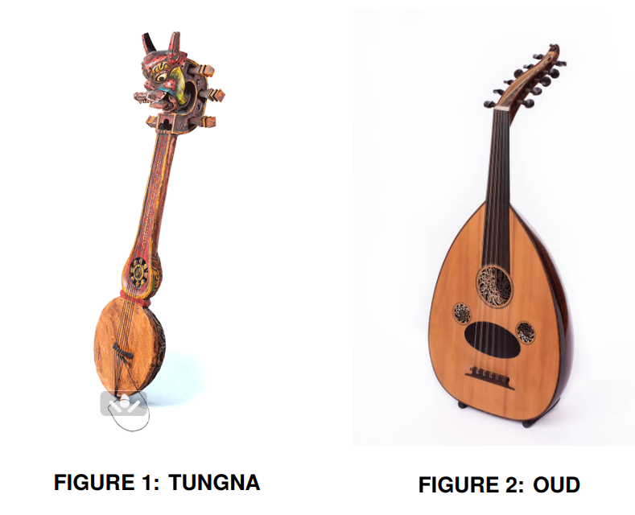

Timbre is the "color" of sound: everything about a note except its pitch and loudness. It is why we can tell two instruments apart even when they play the same note at the same volume.

This study quantifies the timbre of two underrepresented instruments: the Tungna of the Himalayas, with a small goat-skin resonator, and the Oud of the Middle East, with a large pear-shaped body. The hypothesis is that their construction leaves a measurable mark on their sound.

Each instrument was recorded at 44.1 kHz and analyzed through two determinants of timbre. The sound envelope, extracted with the Hilbert transform, gives attack and decay times. The power spectral density, computed with Welch's method, gives the energy in each harmonic.

The Tungna attacks in 36 ms and decays in 46 ms. The Oud takes 111 ms and 1,064 ms, which fits its much larger resonator. The Tungna's harmonics are distinctive too: its dominant harmonic shifts from the 3rd to the 2nd to the 1st as pitch rises, a pattern not seen in the Oud.
