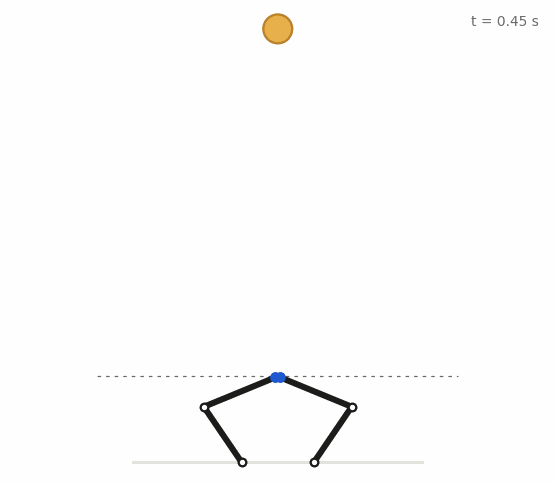
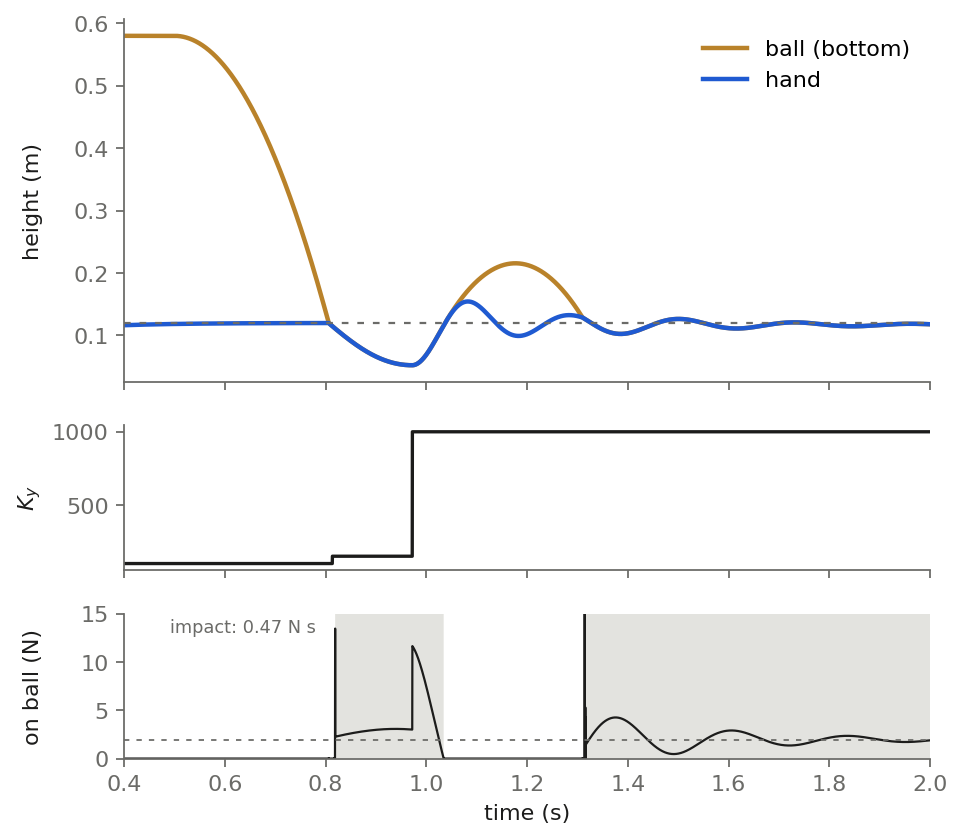
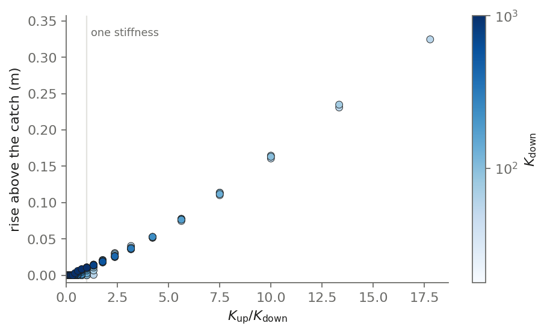

MIT 2.74, Bio-inspired Robotics.

A setter's hands give as the ball arrives and firm up as they push it away. This project tests that on a robot: two two-link arms set a falling ball, and the stiffness of their hands changes between the catch and the push.



{}
Each hand is a virtual spring-damper about a setpoint, implemented with Khatib's operational space control:

$$
\tau = J^\top \big( \Lambda (K e + D \dot e) + \mu + \rho \big), \qquad \Lambda = (J M^{-1} J^\top)^{-1}
$$

The hands are stiff horizontally, so they stay together. Vertically, stiffness switches from \(K_\text{down}\) on the catch to \(K_\text{up}\) on the push.
{}

{}
The impact is a discrete, perfectly plastic collision between the ball and the hand's effective mass, \(m_e = (J_y M^{-1} J_y^\top)^{-1}\).
{}

{}
Sweeping \(K_\text{down}\) and \(K_\text{up}\) maps the height of the set. A soft catch and a stiff push (\(K_\text{down} = 56\), \(K_\text{up} = 1000\)) send the ball 0.33 m above the hands. A single stiffness lifts it about a centimetre.

The soft spring lets the hand sink far below its setpoint. Stiffening at the bottom adds energy, and the push returns it to the ball. So the rise depends on the ratio \(K_\text{up}/K_\text{down}\), not on either stiffness alone, and it keeps growing with the ratio. What caps it is the hardware. Hand travel limits the catch: softer than \(K_\text{down} \approx 53\), the hand hits its mount before the ball stops. Actuator torque limits the push: past \(K_\text{up} \approx 1000\) the push starts hitting the motors' torque limit, and by 2000 it spends most of the stroke there and can throw the arm fully straight.





. Hollow dots are runs where the arm went fully straight.")
{}

{}
An Mbed runs the impedance controller at 1 kHz over a 5 kHz current loop. Contact is detected from a spike in the hand-joint velocity, after which the controller stiffens and launches.
{}
